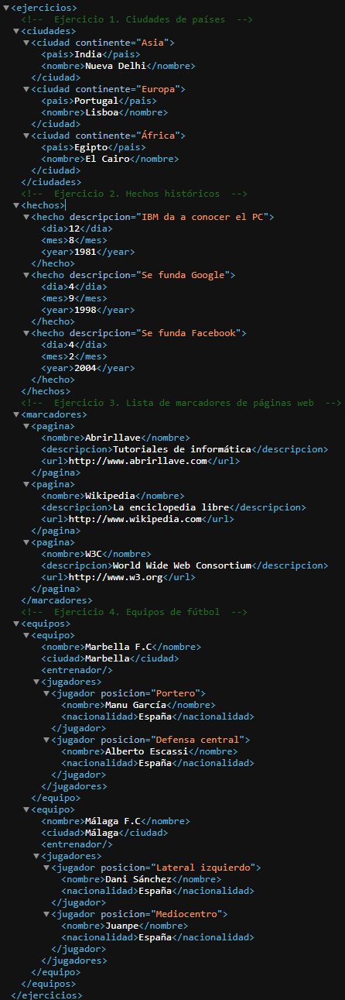

# Tarea 1: Modelado de Datos y Atributos en XML
Ejercicio práctico del módulo Lenguajes de Marcas y Sistemas de Gestión de Información para trabajar la diferencia entre elementos y atributos en la representación de información.

## 🚀 Resultado Visual

## 🛠️ Tecnologías utilizadas
- XML (eXtensible Markup Language)
- Visual Studio Code

## 📋 ¿Qué se hizo? (Funcionalidades)
- Creación de un documento XML de ciudades representadas mediante elementos y su continente correspondiente mediante atributos.
- Estructuración de hechos históricos utilizando atributos para almacenar descripciones y nodos hijo para la descomposición de la fecha (día, mes, año).
- Creación de una lista de marcadores de páginas web (nombre, descripción y URL) representada exclusivamente mediante elementos (sin atributos).
- Diseñado de la estructura de un documento de equipos de fútbol y sus jugadores, diferenciando posiciones mediante atributos en el elemento jugador.

## ⚙️ Cómo ejecutarlo localmente
1. Abre los archivos `.xml` en el navegador para validar que el documento esté bien formado.
2. Revisa la correcta anidación de nodos y la sintaxis de atributos.