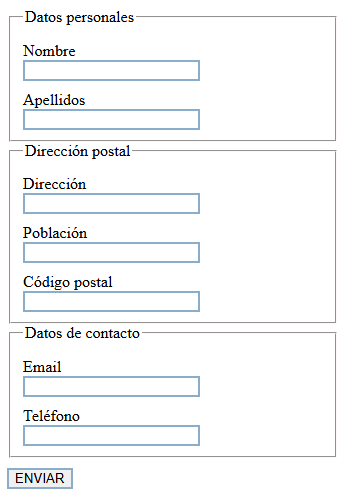

# Tarea: Práctica de Formatos e Interacción en HTML5
Ejercicio práctico del módulo Lenguajes de Marcas y Sistemas de Gestión de Información para el uso de etiquetas de texto, jerarquías de encabezados y estilos básicos en documentos web.

## 🚀 Resultado Visual

## 🛠️ Tecnologías utilizadas
- HTML5
- CSS3 (Estilos de texto y fondos)
- Visual Studio Code

## 📋 ¿Qué se hizo? (Funcionalidades)
- Maquetación de un documento estructurado con títulos jerárquicos (`<h1>`, `<h2>`) y párrafos de texto.
- Aplicación de colores de fondo, imágenes de fondo y personalización de estilos de tipografía.
- Organización de secciones de teoría y metodologías educativas mediante bloques de texto diferenciados.

## ⚙️ Cómo ejecutarlo localmente
1. Abre el archivo `index.html` en cualquier navegador web para visualizar la maquetación.