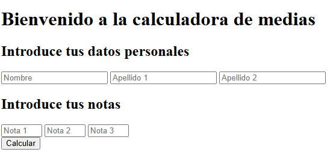

# Tarea: Diseño y Agrupación de Formularios HTML5
Ejercicio práctico del módulo Lenguajes de Marcas y Sistemas de Gestión de Información para capturar datos de usuario a través de controles de entrada y elementos de agrupación.

## 🚀 Resultado Visual

## 🛠️ Tecnologías utilizadas
- HTML5
- Visual Studio Code

## 📋 ¿Qué se hizo? (Funcionalidades)
- Agrupación lógica de campos mediante `<fieldset>` y leyendas descriptivas (`<legend>`) para Datos Personales, Dirección Postal y Datos de Contacto.
- Implementación de controles interactivos: cajas de texto, casillas de verificación (*checkbox*), listas desplegables (`<select>`) y botones de envío/borrado.
- Creación de interfaz para la calculadora de notas medias (entradas numéricas para notas y datos del alumno).

## ⚙️ Cómo ejecutarlo localmente
1. Abre el archivo `.html` en tu navegador web para interactuar con los campos del formulario.