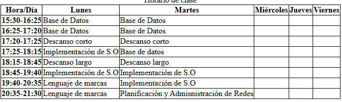

# Tarea: Diseño de Tablas Horarias en HTML5
Ejercicio práctico del módulo Lenguajes de Marcas y Sistemas de Gestión de Información para maquetar datos bidimensionales mediante tablas.

## 🚀 Resultado Visual

## 🛠️ Tecnologías utilizadas
- HTML5
- Visual Studio Code

## 📋 ¿Qué se hizo? (Funcionalidades)
- Construcción del horario lectivo semanal mediante la etiqueta `<table>` y sus componentes (`<tr>`, `<th>`, `<td>`).
- Uso de atributos de combinación de celdas (`colspan` y `rowspan`) para estructurar pausas y descansos.
- Distribución clara de horas, días de la semana y asignaturas del ciclo formativo.

## ⚙️ Cómo ejecutarlo localmente
1. Abre el archivo `.html` en el navegador para comprobar la alineación y estructura de la tabla.