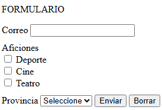

# Tarea: Diseño y Agrupación de Formularios HTML5
Ejercicio práctico del módulo Lenguajes de Marcas y Sistemas de Gestión de Información para capturar datos de usuario a través de controles de entrada y elementos de agrupación.

## 🚀 Resultado Visual

## 🛠️ Tecnologías utilizadas
- HTML5
- CSS
- Visual Studio Code

## 📋 ¿Qué se hizo? (Funcionalidades)
- Creación de un formulario con campo de correo electrónico.
- Implementación de casillas de verificación (*checkbox*) para la selección múltiple de aficiones (Deporte, Cine, Teatro).
- Creación de una lista desplegable (`<select>`) con opciones de provincias (Álava, Barcelona, Madrid, Sevilla).
- Añadido de botones de interacción para enviar datos (`submit`) y limpiar el formulario (`reset`).

## ⚙️ Cómo ejecutarlo localmente
1. Abre el archivo `index.html` en tu navegador web para interactuar con los campos del formulario.