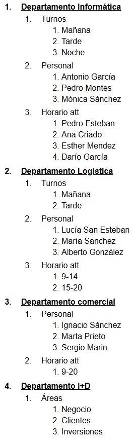

# Tarea: Estructuración de Listas Anidadas en HTML5
Ejercicio práctico del módulo Lenguajes de Marcas y Sistemas de Gestión de Información para organizar contenidos mediante listas ordenadas y desordenadas.

## 🚀 Resultado Visual

## 🛠️ Tecnologías utilizadas
- HTML5
- CSS
- Visual Studio Code

## 📋 ¿Qué se hizo? (Funcionalidades)
- Creación de una estructura multinivel de departamentos de la empresa (Informática, Logística, Comercial e I+D).
- Anidamiento de listas ordenadas (`<ol>`) para clasificar turnos, personal técnico y horarios de atención.
- Aplicación de buenas prácticas de marcado HTML para la correcta jerarquización de contenidos textuales.

## ⚙️ Cómo ejecutarlo localmente
1. Abre el archivo `.html` en tu navegador de preferencia.