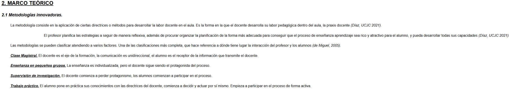

# Tarea Complementaria 1: Formatos de Texto y Maquetación Web
Ejercicio práctico del módulo Lenguajes de Marcas y Sistemas de Gestión de Información para aplicar estilos de texto, jerarquías de contenido y alineaciones mediante HTML5 y CSS3.

## 🚀 Resultado Visual

## 🛠️ Tecnologías utilizadas
- HTML5
- CSS3 (Estilos incrustados)
- Visual Studio Code

## 📋 ¿Qué se hizo? (Funcionalidades)
- **Estructuración jerárquica de contenidos**: Uso de encabezados (`<h2>`, `<h3>`) para organizar la sección teórica de metodologías innovadoras.
- **Tipografía y formato de texto**:
  - Transformación a mayúsculas (`text-transform: uppercase`) y subrayado (`text-decoration: underline`) en títulos principales.
  - Aplicación de negritas, cursivas y subrayados combinados (`<i><b><u>`) para destacar conceptos clave (Clase Magistral, Trabajo práctico, etc.).
- **Alineación y maquetación de párrafos**:
  - Implementación de sangría inicial de párrafo (`text-indent: 40px`).
  - Creación de clases CSS para alineación justificada (`.texto-justificado`) y centrada (`.texto-centrado`).
  - Ajuste de interlineado (`line-line-height: 1.6`) y márgenes generales para mejorar la legibilidad.

## ⚙️ Cómo ejecutarlo localmente
1. Abre el archivo `tareacomplementaria1.html` en cualquier navegador web.
2. Revisa la aplicación de los estilos y la correcta alineación de las secciones de texto.