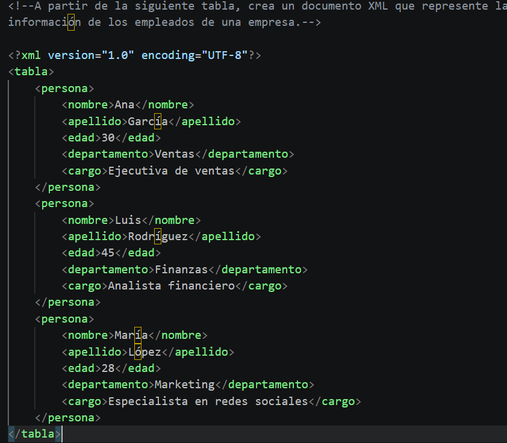

# Tarea Complementaria 2: Corrección, Estructuración y Modelado en XML
Ejercicio práctico del módulo Lenguajes de Marcas y Sistemas de Gestión de Información enfocado en la corrección de errores de sintaxis en XML y en la creación de estructuras de datos bien formadas para distintas entidades.

## 🚀 Resultado Visual

## 🛠️ Tecnologías utilizadas
- XML (eXtensible Markup Language)
- Visual Studio Code

## 📋 ¿Qué se hizo? (Funcionalidades)
- **Corrección de documentos mal formados (`tareac2.xml` y `tareac2.1.xml`)**:
  - Ajuste de etiquetas mal cerradas, elementos vacíos sin sintaxis válida (`<deporte Atletismo />` → `<deporte>Atletismo</deporte>`), coincidencia de mayúsculas/minúsculas en etiquetas de apertura/cierre (`<Titulo>` vs `</titulo>`) y nombres de etiquetas inválidos como nombres de dominio (`<http://>`).
- **Modelado de Agenda de Contactos (`tareac2.2.xml`)**:
  - Estructuración de contactos con un único nombre y cardinalidad variable para elementos anidados de correos electrónicos y teléfonos.
- **Representación de Datos de Empleados (`tareac2.3.xml`)**:
  - Conversión de información tabular de personal a un árbol de nodos XML estructurado por personas y sus atributos profesionales.
- **Creación de Catálogo de Productos (`tareac2.4.xml`)**:
  - Diseño de un catálogo con nombre, descripción, precio y lista de características detalladas por producto.

## ⚙️ Cómo ejecutarlo localmente
1. Abre cualquiera de los archivos `.xml` (`tareac2.xml`, `tareac2.1.xml`, `tareac2.2.xml`, `tareac2.3.xml`, `tareac2.4.xml`) en Visual Studio Code o en cualquier navegador web.
2. Verifica que el navegador o el validador XML muestre el árbol de nodos correctamente sin errores de formato.